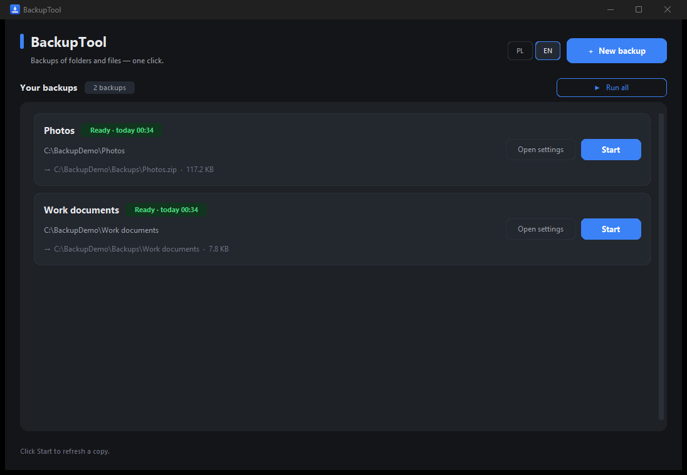
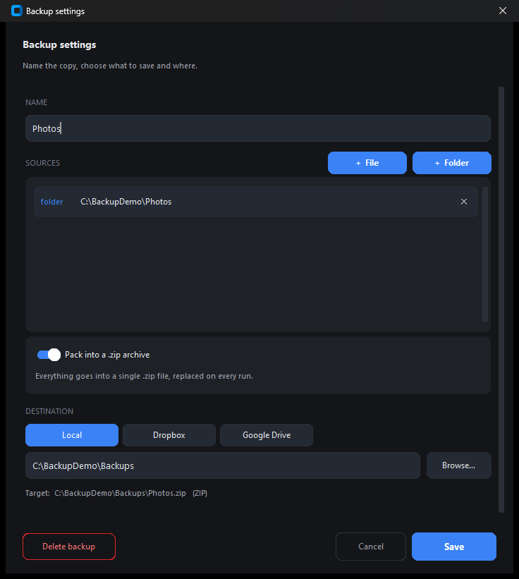

# BackupTool

A small, simple backup tool for Windows. Pick a folder or a file, name the copy, choose
where it goes — then press **Start** whenever you want to refresh it.



## Download

Grab `BackupTool.exe` from the [latest release](../../releases/latest) and run it. No
installer, no Python, no admin rights.

Windows may show an "unknown publisher" warning — click **More info** → **Run anyway**.

## What it does

- **Any source** — a folder, a file or several of them in one backup.
- **ZIP or folder** — your choice. If a source is already an archive (`.zip`, `.rar`,
  `.7z`…), it is copied unchanged instead of being packed twice.
- **Remembers everything** — name, sources and destination are stored in
  `%APPDATA%\BackupTool\backups.json`, so the next run is one click.
- **Run all** — refreshes every backup in the list, one after another.
- **App data** — optional one-switch backup of supported apps; they are detected
  automatically and the section shows whether they were found on this computer.
- **Cloud** — destination can be **Dropbox** or **Google Drive**. Sign-in happens in the
  browser; the token is kept on your machine only.
- **Get it back** — a backup with a cloud destination has a **Download** button: it first
  checks the copy in the cloud and shows its size and date, then saves the archive wherever
  you point it. An existing file is never overwritten (`kopia (2).zip` instead). While it runs
  the row turns into **Stop** — a stopped download leaves no half file behind.



## Notes

- Folder mode overwrites existing files and adds new ones, but never deletes anything.
- ZIP mode builds the archive from scratch, so it always matches the source.
- SQLite databases are copied through a snapshot, so the copy stays consistent even
  while the source app is running.
- Cloud uploads always use a single ZIP file — uploading thousands of separate files
  hits API limits and is far slower.
- Google Drive needs your own OAuth client ID (free, one time). The app has a short
  step-by-step guide behind **"How to get it?"**.
- Credential files such as `auth.json`, `.env` or `connections.json` are never part of a
  backup.

## Build from source

```bash
uv venv --python 3.11 .buildenv
uv pip install --python .buildenv/Scripts/python.exe customtkinter pillow pyinstaller
python -m unittest discover -s tests
.buildenv/Scripts/python.exe -m PyInstaller --noconfirm BackupTool.spec
```

Layout: `app.py` (UI), `backup_core.py` (state, copy engine, ZIP, SQLite snapshots),
`appdata_detect.py` (app data detection), `cloud.py` (rclone), `i18n.py`
(English/Polish strings).

## License

MIT — see [LICENSE](LICENSE).
